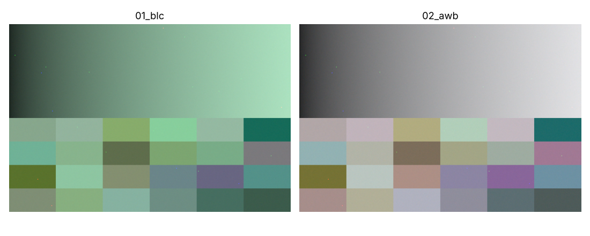
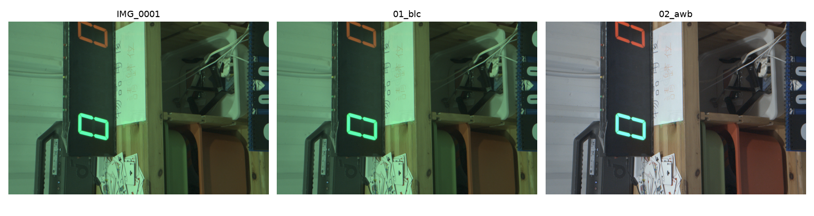
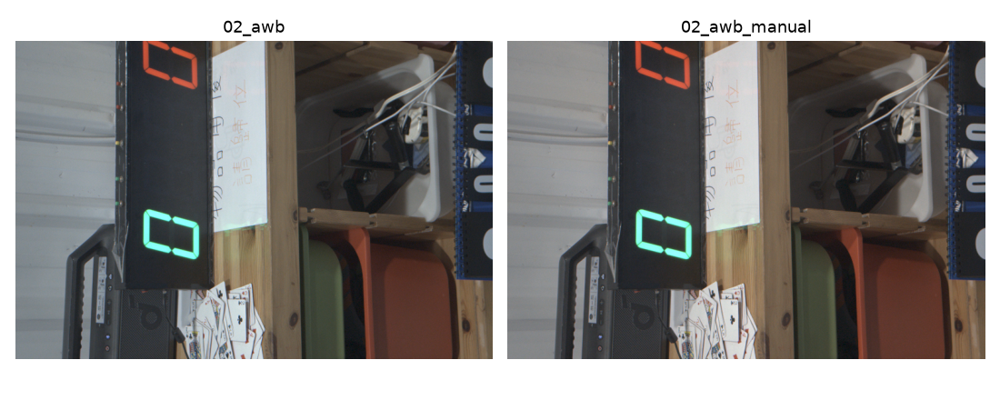
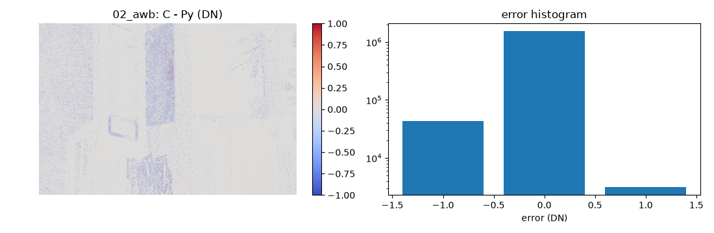

# mini-isp

A RAW-to-RGB image signal processor built two ways and checked against each other:

* **`python_ref/`** — floating-point reference model: readable, config-driven, one module per stage
* **`c_model/`** — fixed-point C11 model: integer-only arithmetic, written the way ISP hardware is

Every stage dumps its output from both models, and `verify/` reports the bit-level difference
against a per-stage tolerance. CI fails if any stage drifts. Input can be a **synthetic RAW with
known ground truth** or a **real DNG** from a camera or phone.



## Status

| # | Stage | Python ref | C fixed-point | Verified (max abs err) | Notes |
|---|---|---|---|---|---|
| 1 | Black level correction | ✅ | ✅ | 0 DN (bit-exact) | [docs/01_blc.md](docs/01_blc.md) |
| 2 | White balance (gray world) | ✅ | ✅ Q3.10 gains | ≤ 1 DN | [docs/02_awb.md](docs/02_awb.md) |
| 3 | Defect pixel correction | ⬜ | ⬜ | | |
| 4 | Demosaic (bilinear → Malvar-He-Cutler) | ⬜ | ⬜ | | |
| 5 | Color correction matrix | ⬜ | ⬜ | | |
| 6 | Gamma / tone curve (LUT) | ⬜ | ⬜ | | |

Input: synthetic RAW ✅ · real Bayer DNG (rawpy) ✅
IQ metrics: PSNR ✅ · SSIM ⬜ · ΔE2000 ⬜ · slanted-edge MTF ⬜

See [ROADMAP.md](ROADMAP.md) for the milestone plan.

## Results on a real photo

`picture/IMG_0001.DNG` — 12-bit BGGR, 4032×3024, centre crop 1536×1024, black level 528.
Previews are half-resolution RGB (no demosaic yet) with display gamma 2.2.

**Input → BLC → AWB (gray world)**



* **BLC** subtracts 528 DN; white level 4095 → 3567. The image barely changes visually, but every
  later gain now scales signal only, not the black pedestal.
* **AWB** removes the strong green cast of the raw sensor data. Gray-world gains: **R = 2.178,
  B = 1.977** (G = 1).

**Gray world vs the camera's as-shot white balance**



| | R gain | B gain |
|---|---|---|
| Gray world (estimated) | 2.178 | 1.977 |
| Camera as-shot (from DNG) | 2.419 | 1.880 |

Gray world comes out slightly cooler than the camera: the large white and gray surfaces in the
scene pull the average toward neutral, and gray world has no notion of the light source.

**C fixed-point vs Python float (AWB stage)**



| stage | max abs | mean abs | exact match | tol | result |
|---|---|---|---|---|---|
| 01_blc | 0 | 0.0000 | 100.00% | 0 | PASS |
| 02_awb | 1 | 0.0298 | 97.02% | 3 | PASS |

The only error is ±1 DN rounding from Q3.10 gains (R = 2230/1024, B = 2024/1024).

To reproduce, see [Walkthrough](#real-dng) below; to refresh the images after a new run:

```bash
python3 tools/preview.py data/IMG_0001 out/step/01_blc out/step/02_awb --out docs/img/IMG_0001_stages.png
python3 tools/preview.py out/step/02_awb out/step/02_awb_manual --out docs/img/IMG_0001_awb_compare.png
cp out/verify/02_awb_diff.png docs/img/IMG_0001_awb_diff.png
```

## Requirements

| | Version | Notes |
|---|---|---|
| OS | Ubuntu 22.04 / 24.04 or later, WSL2 | any Linux with Python and a C compiler should work |
| Python | ≥ 3.10 (tested on 3.11 – 3.14) | run inside a virtual environment, see below |
| C compiler | gcc or clang with C11 | for the fixed-point model in `c_model/` |
| Tools | `make`, `git` | |

Python packages are listed in [`requirements.txt`](requirements.txt):

| Package | Used for |
|---|---|
| `numpy` | all image arithmetic |
| `pyyaml` | pipeline config (`configs/*.yaml`) |
| `matplotlib` | previews, error heat maps |
| `rawpy` | reading real DNG files (LibRaw wrapper) |
| `pytest`, `ruff` | tests and lint (also run by CI) |

## Build

### 1. System packages

```bash
sudo apt update
sudo apt install python3-full python3-venv build-essential make git
python3 --version        # must be 3.10 or newer
```

`python3-full` / `python3-venv` provide the `venv` module; `build-essential` provides `gcc`.

### 2. Get the code

```bash
git clone https://github.com/ame860915/mini-isp
cd mini-isp
```

### 3. Create the Python virtual environment (once)

Recent Ubuntu / Debian releases block `pip install` into the system Python
(`error: externally-managed-environment`, PEP 668). All Python packages therefore go into a
project-local virtual environment in `.venv/` (git-ignored):

```bash
python3 -m venv .venv                 # create the environment
source .venv/bin/activate             # activate it; the prompt now starts with (.venv)
python -m pip install --upgrade pip
pip install -r requirements.txt       # numpy, pyyaml, matplotlib, rawpy, pytest, ruff
```

Check the installation:

```bash
which python3                         # -> .../mini-isp/.venv/bin/python3
python3 -c "import numpy, yaml, matplotlib, rawpy; print('ok, rawpy', rawpy.__version__)"
```

### 4. Build the C model and run the tests

```bash
make c          # builds c_model/build/mini_isp_c
make test       # Python unit tests
make verify     # end-to-end: synthetic RAW -> Python ref -> C model -> stage-by-stage diff
```

If all three succeed, the setup is complete.

### Everyday use

Every new terminal needs the environment activated once:

```bash
cd mini-isp
source .venv/bin/activate      # python3 / pip / make now use .venv
...
deactivate                     # leave the environment when done
```

The `Makefile` sets `PYTHONPATH=python_ref`, so `make` targets and the `tools/*.py` scripts work
without installing the package. To call the pipeline module directly, set it yourself:

```bash
PYTHONPATH=python_ref python3 -m mini_isp.pipeline --input data/synth --config configs/default.yaml
```

To start over with a clean environment: `deactivate; rm -rf .venv` and repeat step 3.

**VS Code (WSL):** open the folder with the *WSL* extension, then
*Python: Select Interpreter* → `./.venv/bin/python`.

### Troubleshooting

| Symptom | Fix |
|---|---|
| `error: externally-managed-environment` | the venv is not active: `source .venv/bin/activate` |
| `No module named venv` / `ensurepip is not available` | `sudo apt install python3-full python3-venv` |
| `pip install rawpy` builds from source and fails | no prebuilt wheel for your Python yet: `sudo apt install libraw-dev pkg-config`, then retry |
| `No module named mini_isp` | run through `make`, or prefix the command with `PYTHONPATH=python_ref` |
| `cc: command not found` | `sudo apt install build-essential` |
| everything is slow under `/mnt/c`, `/mnt/d` | WSL disk access to Windows drives is slow; keep the repo under `~/` |

## Usage

### Synthetic RAW (ground truth known)

```bash
make verify     # synthetic RAW -> Python ref -> C model -> stage-by-stage diff
make preview    # half-res quick look of each stage -> out/preview.png
```

### Real DNG

Put your photos in `picture/` (git-ignored, never committed). Only 2×2 Bayer DNGs are supported
(not X-Trans, not Apple ProRAW or other linear/demosaiced DNGs).

**One command** — import + Python ref + C model + verify + preview:

```bash
make dng DNG=picture/IMG_0001.DNG                     # full frame
make dng DNG=picture/IMG_0001.DNG CROP="1536 1024"    # centre crop first, much faster on 12-50 MP files
```

**Step by step** — run BLC and AWB one at a time and look at each result:

```bash
# 1. DNG -> exchange format (data/IMG_0001.raw + .json)
python3 tools/import_dng.py picture/IMG_0001.DNG --crop 1536 1024

# 2. metadata + per-CFA-channel statistics (black/white level, CFA, as-shot WB)
python3 tools/inspect_raw.py data/IMG_0001

# 3. BLC: subtract black level (528 -> 0, white level 4095 -> 3567)
python3 tools/run_stage.py --stage blc --input data/IMG_0001 --out out/step/01_blc

# 4. AWB: gray-world gain estimate on the BLC output
python3 tools/run_stage.py --stage awb --input out/step/01_blc --out out/step/02_awb

# 4b. (optional) AWB with manual gains, e.g. the camera's as-shot values
python3 tools/run_stage.py --stage awb --input out/step/01_blc --out out/step/02_awb_manual \
    --params '{"method": "manual", "gains": {"R": 2.4187, "G": 1.0, "B": 1.8799}}'

# 5. side-by-side quick look
python3 tools/preview.py data/IMG_0001 out/step/01_blc out/step/02_awb --out out/step/preview.png

# 6. (optional) check the C fixed-point model against the Python reference
make c
make verify INPUT=data/IMG_0001
```

Real photos have no ground truth; the camera's own as-shot white balance is kept in the
metadata as `as_shot_awb_gains` for comparison with the AWB estimate.

> **WSL:** Windows drives are under `/mnt/c/...`, `/mnt/d/...`, e.g.
> `make dng DNG=/mnt/d/photos/IMG_0001.DNG`.

### Example output

```
$ make dng DNG=picture/IMG_0001.DNG CROP="1536 1024"
[dng] IMG_0001.DNG -> data/IMG_0001.raw  1536x1024 BGGR  black=528 white=4095 (12-bit)
[dng] centre crop from 4032x3024 at (x=1248, y=1000)
[dng] camera as-shot gains R=2.4187 B=1.8799  (reference only, not ground truth)
[py] 2 stages -> out/py  (blc, awb)
[py] AWB gains R=2.1777 G=1.0000 B=1.9770
[c ] gains Q10: R=2230 G=1024 B=2024  -> out/c
| stage  | max abs | mean abs | exact match | tol | result |
|--------|---------|----------|-------------|-----|--------|
| 01_blc | 0       | 0.0000   | 100.00%     | 0   | PASS   |
| 02_awb | 1       | 0.0298   | 97.02%      | 3   | PASS   |
```

| Output | Content |
|---|---|
| `out/py/NN_<stage>.raw/.json` | Python stage dumps |
| `out/step/` | single-stage results from `tools/run_stage.py` |
| `out/c/NN_<stage>.raw` | C stage dumps |
| `out/py/params.json` | parameters handed from "firmware" to "hardware" (e.g. AWB gains) |
| `out/verify/report.md`, `*_diff.png` | per-stage error table, heat maps, histograms |
| `out/preview.png` | half-res RGB of each stage (no demosaic yet) |

## Design

```
            ┌──────────── Python float reference ────────────┐
RAW ──────► │ BLC → AWB → DPC → Demosaic → CCM → Gamma → ... │ ──► stage dumps (out/py)
 │          └──────────────────────┬──────────────────────────┘
 │                                 │ params (AWB gains, ...)  = firmware → hardware hand-off
 │          ┌──────────── C fixed-point model ───────────────┐
 └────────► │ same stages, integer arithmetic                │ ──► stage dumps (out/c)
            └────────────────────────────────────────────────┘
                                   ▼
                        verify/compare.py: per-stage error, heat map, PASS/FAIL
```

* **One interface per stage**: `(image, meta) -> (image, meta)` in Python; `stage(in, out, params)`
  in C. Adding a stage never touches the pipeline core.
* **Config, not code**: stage order and parameters live in `configs/*.yaml`.
* **Ground truth first**: `tools/make_synthetic.py` makes a Bayer RAW with known black level,
  illuminant gains, noise model and hot-pixel positions, so each module is checked against a
  known answer before it runs on real DNGs.
* **Firmware / hardware split**: statistics → gain estimation in float (firmware); gain
  application in fixed point (hardware), mirroring how a camera SoC divides the work.
* **One exchange format**: little-endian `uint16` `.raw` + `.json` metadata, simple enough that
  the C side needs no library. Synthetic data, imported DNGs and every stage dump use it.

## Tools

| Command | Purpose |
|---|---|
| `tools/make_synthetic.py` | synthetic Bayer RAW with ground truth |
| `tools/import_dng.py` | real DNG → `.raw/.json` (CFA, black/white level, as-shot WB, optional crop) |
| `tools/inspect_raw.py` | metadata, per-CFA-channel statistics, a pixel block |
| `tools/run_stage.py` | run one Python stage on one input, e.g. to try manual AWB gains |
| `tools/diff_raw.py` | diff any two dumps of the same size |
| `tools/preview.py` | half-res quick-look PNG of stage dumps |

## Repository layout

```
python_ref/mini_isp/   float reference: modules/, pipeline, synthetic data, RAW/DNG I/O
c_model/               fixed-point C11 model (include/isp.h, src/*.c, Makefile)
verify/                run C with Python's params, diff every stage
iq/                    image-quality metrics
tools/                 synthetic data, DNG import, inspection, previews
docs/                  one engineering note per module
picture/               your own DNG photos (git-ignored)
configs/               pipeline + verification tolerances
tests/                 pytest unit tests
data/                  imported .raw/.json dumps (git-ignored except README)
requirements.txt       Python dependencies
```

## References

* M. S. Brown, *Understanding Color and the In-Camera Image Processing Pipeline*, ICCV 2019 tutorial
* R. Sumner, *Processing RAW Images in MATLAB*
* H. S. Malvar, L. He, R. Cutler, *High-quality linear interpolation for demosaicing of
  Bayer-patterned color images*, ICASSP 2004
